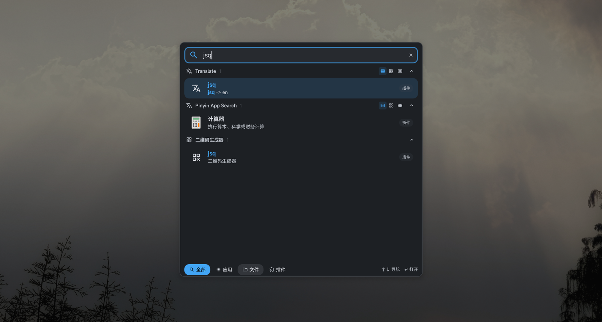

# Pinyin App Search — DMS 启动器拼音搜索插件

给 [DankMaterialShell (DMS)](https://github.com/AvengeMedia/DankMaterialShell) 的启动器加上**拼音 / 首字母搜索中文应用名**的能力。



```
jsq       → 计算器
jisuanqi  → 计算器
wenjian   → 文件
wpswz     → WPS 文字
hshwk     → 黑神话：悟空
```

**不改任何 `.desktop` 文件**：索引在运行时从 `DesktopEntries` 生成，卸载插件即完全还原，升级 DMS / 装删应用都无需维护。

## 为什么需要它

DMS 的 `AppSearchService.searchApplications()` 只匹配这几个字段：

| 字段 | 权重 |
|---|---|
| `Name` 完全/前缀/词首/子串 | 10000 / 5000 / 3000 / 500 |
| `GenericName` | 800 / 400 |
| `id` | 350 |
| `Keywords` | 300 / 150 |
| `Comment` | 50 |
| `Name` 的 Levenshtein 模糊 | ≈100–300 |

**没有任何拼音转换**。中文界面下应用显示为 `Name[zh_CN]`（如 `计算器`），打 `jisuanqi` 时它拿中文串做 ASCII 编辑距离，永远不命中。

常见的"解法"是往 `.desktop` 的 `Keywords=` 里塞拼音（XDG 覆盖文件），但那样会：

- 生成一堆 `~/.local/share/applications/` 覆盖文件，系统升级后 Exec 可能变陈旧；
- 需要定时任务/包管理器钩子持续维护；
- 污染用户自己的 desktop 文件。

本插件用 DMS 的 launcher plugin API 做同样的事，副作用为零。

## 安装

```bash
git clone https://github.com/<you>/dms-plugin-pinyin-app-search.git
cd dms-plugin-pinyin-app-search
./install.sh          # 复制到 ~/.config/DankMaterialShell/plugins/pinyinAppSearch
```

然后启用（二选一）：

**A. 界面**：DMS 设置 → Plugins → 找到 **Pinyin App Search** → 打开开关。

**B. 命令行**：

```bash
python3 - <<'EOF'
import json, pathlib
p = pathlib.Path.home() / ".config/DankMaterialShell/plugin_settings.json"
d = json.loads(p.read_text()) if p.exists() else {}
d.setdefault("pinyinAppSearch", {}).update({"enabled": True, "noTrigger": True})
p.write_text(json.dumps(d, indent=2))
EOF
systemctl --user restart dms.service   # 新启用的插件需要重载 shell
```

> `noTrigger: true` 是让结果常驻参与搜索的关键。DMS 的 `PluginService.getPluginTrigger()` 里
> `plugin.trigger || "!"` 会把空串回落到 `"!"`，所以 manifest 里写空 trigger 不管用，必须落到 plugin_settings。

打开启动器，输入 `jsq`，应该能看到 **计算器**（带「插件」来源徽标）。

## 配置

设置页可调：

| 选项 | 默认 | 说明 |
|---|---|---|
| 最多结果数 | 8 | 1–20 |
| 最短查询长度 | 2 | DMS 本身在查询 <2 字符时不进入插件阶段，设 1 无效 |
| 匹配类型名拼音 | 关 | 也索引 `GenericName`（如「媒体播放器」） |
| 匹配描述拼音 | 关 | 也索引 `Comment`，容易出噪音 |

## 已知限制（DMS 侧行为，插件无法绕过）

1. **只在「全部」和「插件」两种模式生效。** `Controller._performPluginPhase()` 里写死了
   `if (searchMode !== "all") return` —— 你在「应用」标签页下输入，插件项不参与。
   用 `Ctrl+1` 切到「全部」即可。
2. **查询 ≥2 字符**才进入插件阶段，单字母缩写不生效。
3. 结果排在中英文真名匹配之后（插件项分值为 `900 - index`），这是有意的：拼音是兜底，不抢精确匹配。

## 实现要点

- `data/pinyin-dict.js` 是 `.pragma library`，内含 26703 个汉字的音节表 + 5874 个多音字的优先级列表（≈233KB，纯文本，无需任何运行时依赖）。
- 应用名逐字转写，多音字展开成最多 6 个候选串（`乐` 同时覆盖 `le` / `yue`），首字母索引一并生成。
- 打分：首字母完全匹配 1000 → 首字母前缀 960 → 全拼完全 940 → 全拼前缀 920 → 包含 880/850。
- **原生已能命中就跳过**（`name`/`genericName`/`id`/`keywords` 含查询串时不输出重复项）。
- 执行走 `SessionService.launchDesktopEntry()`，与 DMS 原生启动同一条路（`runInTerminal`、启动前缀、光标环境、NVIDIA 全部继承）。
- `DesktopEntries.applicationsChanged` 触发重建索引，装删应用即时生效。

## 开发

重新生成字典（需要 pypinyin）：

```bash
python3 -m venv .venv && .venv/bin/pip install pypinyin
.venv/bin/python tools/gen_dict.py
```

改完 QML 后同步到插件目录并重载：

```bash
cp *.qml data/*.js ~/.config/DankMaterialShell/plugins/pinyinAppSearch/ 2>/dev/null
systemctl --user restart dms.service
```

查看加载错误：

```bash
journalctl --user -u dms.service --since "-2min" | grep -iE 'pinyin|component error'
```

### 踩坑备忘

- `QtObject` **没有默认属性**，`Connections { }` 不能裸写，必须挂成 `property Connections foo: Connections { ... }`，否则报
  `Cannot assign to non-existent default property` 且插件静默不出现。
- `DesktopEntry.id` **不带 `.desktop` 后缀**（`org.gnome.Calculator`，不是 `.desktop` 结尾），用错就查不到条目。
- 插件 `enabled` 只在解析 manifest 那一刻读取，改完 `plugin_settings.json` 要重启 `dms.service`。

## License

MIT
